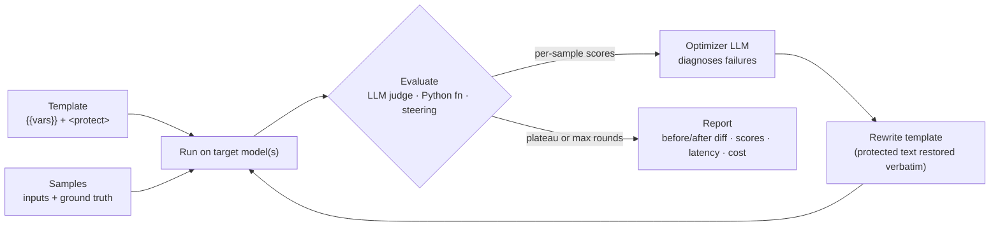

# Prompt Lab

**Open, model-agnostic prompt optimization.** Give it a prompt template, a handful of test samples and a definition of "good". It runs the prompt, scores every answer, asks an optimizer model *why* the low scorers failed, rewrites the prompt and repeats until scores stop improving.

Works with any OpenAI-compatible endpoint: Groq, Gemini, OpenRouter, OpenAI, or a local vLLM/Ollama server. Pure Python standard library, no SDK lock-in.

▶ **Try it in your browser:** [readsigil.com/lab](https://readsigil.com/lab/) (bring your own key; it never leaves your browser except to call your provider).



## Why

Cloud prompt optimizers are useful but tied to one vendor and billed per run. Prompt Lab is the same idea as a small, readable library you can point at any model, including free tiers.

## Features

- **Templates with `{{variables}}`**, filled per sample.
- **`<protect>…</protect>` regions** that are never rewritten. If the optimizer touches them, they are restored verbatim; dropped variables are re-added.
- **Three evaluator kinds**
  - *Rubric*: an LLM judge scores 0–10 against your criteria (and ground truth if given).
  - *Function*: any Python `fn(output, sample) -> 0..1` (exact match, JSON schema, regex…).
  - *Steering*: a plain-English goal ("be warmer, under 50 words") judged by an LLM.
- **Plateau detection**: stops after `patience` rounds without at least `min_gain` improvement, on a perfect score, or at `max_rounds`.
- **Compare up to 5 models** on baseline vs optimized prompt.
- **Report**: per-sample scores and judge reasons, mean latency, token counts, cost estimate (from prices you supply) and a unified diff.

## Install

```bash
pip install git+https://github.com/Shashwat-Kumar/promptlab
```

## Library

```python
from promptlab import OpenAICompatModel, Sample, Evaluator, optimize
from promptlab.core import diff
import os

key = os.environ["GROQ_API_KEY"]
target = OpenAICompatModel("openai/gpt-oss-20b", key, "groq")
smart  = OpenAICompatModel("openai/gpt-oss-120b", key, "groq")

samples = [
    Sample({"message": "I was charged twice!"}, '{"category": "billing", "priority": "high"}'),
    Sample({"message": "How do I export to CSV?"}, '{"category": "how_to", "priority": "low"}'),
]
ev = Evaluator(rubric="Bare JSON with category and priority matching EXPECTED.", judge=smart)

res = optimize("Classify: {{message}}\n<protect>Never promise refunds.</protect>",
               samples, ev, target=target, optimizer=smart, max_rounds=4)
print(res["baseline_score"], "->", res["best_score"])
print(diff(res["baseline"], res["best"]))
```

Python-function evaluator:

```python
import json
def exact(out, s):
    "exact JSON match"
    try: return float(json.loads(out) == json.loads(s.expected))
    except Exception: return 0.0
ev = Evaluator(fn=exact)
```

Steering: `Evaluator.steering("Friendly, under 40 words, ends with a question", judge=smart)`.

## CLI

```bash
export GROQ_API_KEY=...
promptlab run examples/ticket_triage.json --out report.json
```

The config holds `template`, `samples`, `evaluator` (`rubric` or `steering`), `target`, `optimizer`, `judge`, optional `compare` (≤5 models), `max_rounds`, `patience`. Providers: `groq`, `gemini`, `openrouter`, `openai`, or any `base_url`. Keys are read from `<PROVIDER>_API_KEY` or `api_key_env`.

## Tests

```bash
pip install pytest && pytest -q
```

Tests use a deterministic `MockModel`, so no network or key is needed.

## Credits

Inspired by the loop described in [AWS Bedrock Advanced Prompt Optimization](https://docs.aws.amazon.com/bedrock/latest/userguide/advanced-prompt-optimization-how.html). This is an independent project with no affiliation with or endorsement by Amazon Web Services.

## License

MIT © Shashwat Kumar
